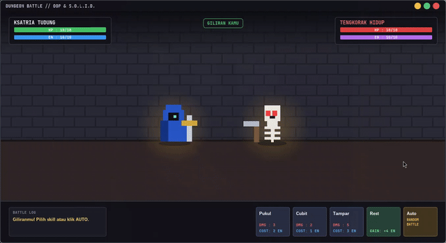

# 🗡️ Dungeon Battle

Duel taktis *turn-based* 1 lawan 1 di ruang bawah tanah: **Ksatria Tudung** melawan **Tengkorak Hidup**.



Bukan sekadar adu klik—kalian berdua sama-sama dibekali **10 Nyawa** dan **10 Energi**. Setiap jurus menguras energi, jadi kamu harus pintar mengatur ritme: kapan waktunya gas menyerang, dan kapan harus menahan diri untuk memulihkan napas sebelum dihabisi balik.

---

## ✨ Fitur Utama

* **Sistem Duel Taktis:** Kelola 10 HP dan 10 Energi dengan cermat di setiap giliran.
* **Aturan Skill Ketat:** Setiap skill punya aturan *balancing* bawaan—nilai damage dan biaya energi tidak boleh sama, dengan selisih maksimal 2 poin. Skill yang melanggar aturan otomatis ditolak sistem (`IllegalArgumentException`).
* **Dialog & Animasi Karakter:** Interaksi pertarungan dilengkapi dialog dinamis dan animasi sprite.
* **Custom Java Swing Window:** Tampilan *window* dibuat kustom dari nol (mulai dari *title bar*, tombol *minimize*, *fullscreen*, *close*, sampai fitur *drag window*).
* **Arsitektur S.O.L.I.D.:** Logika utama game dipisahkan dari urusan penyimpanan data lewat interface `GameRepository` (prinsip *Dependency Inversion*), sehingga mudah diganti antara penyimpanan memori atau PostgreSQL.

---

## 🎮 Cara Main (Langsung Gas)

1. Pastikan **Java 17** atau versi lebih baru sudah terpasang di perangkatmu.
2. Unduh file `game.jar` melalui halaman [Releases](https://github.com/l4utan/dungeon-battle/releases/latest).
3. Buka terminal di folder tempat file diunduh, lalu jalankan:

```bash
java -jar game.jar